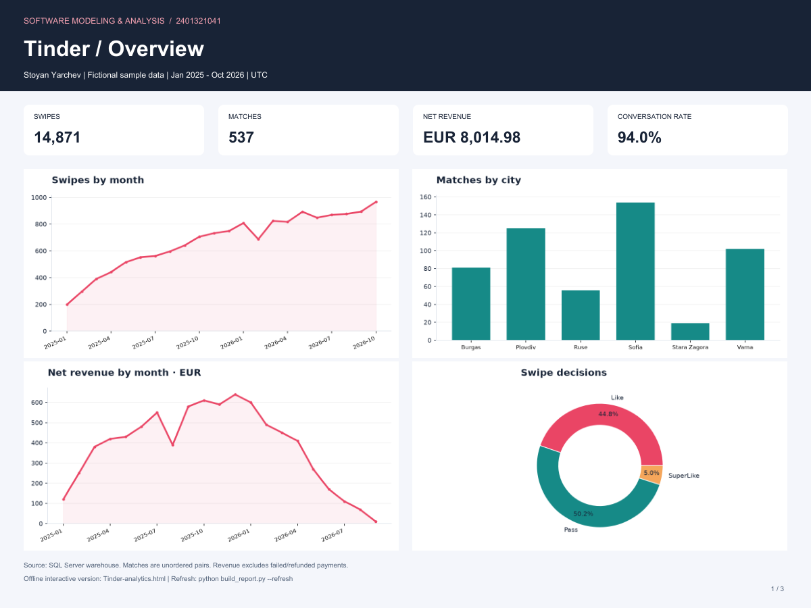

# Tinder — моделиране на данни и бизнес анализи

**Студент:** Стоян Ярчев (Stoyan Yarchev)  
**Факултетен номер:** 2401321041  
**Дисциплина:** Софтуерно моделиране и анализ, Пловдивски университет  
**Тема:** Tinder — учебен модел на платформа за запознанства

Проектът проследява пътя от профил и интереси до харесване, взаимно съвпадение, разговор и платен абонамент. Разработката съдържа релационна база данни, концептуален и логически модел, реално зареден склад от данни и аналитичен отчет. Не представлява официалната архитектура на Tinder. Всички потребители, съобщения и транзакции са синтетични; цените са примерни.

## Бърз преглед

- [Готов Power BI отчет — PBIX](powerbi/Tinder-report.pbix)
- [Аналитичен отчет — PDF](report/Tinder-analytics.pdf)
- [Интерактивен отчет — изтеглете HTML файла и го отворете локално](report/Tinder-analytics.html)
- [Концептуален модел — Chen](diagrams/conceptual_chen.pdf)
- [Логически модел — Crow's Foot](diagrams/logical_crowsfoot.pdf)
- [Data Warehouse — UML](diagrams/dw_uml.pdf)
- [Речник на данните](docs/DATA_DICTIONARY.md)
- [Бизнес изисквания](docs/PROJECT_DESCRIPTION.md)
- [Подготовка за защита](docs/DEFENSE_GUIDE_BG.md)



## Покритие на условието

| Изискване | Реализация |
|---|---|
| Онлайн платформа | Tinder — онлайн платформа за запознанства |
| Концептуален модел — Chen | `diagrams/conceptual_chen.drawio`; същности, атрибути, ключове и връзки |
| Логически модел — Crow's Foot | `diagrams/logical_crowsfoot.drawio`; **13 таблици и 73 атрибута** |
| Поне една връзка M:N | `Users ↔ Interests`, разрешена с `UserInterests(UserID, InterestID)` |
| Релационна база данни | MS SQL Server: `TinderDB_2401321041` |
| Съхранена процедура | `usp_RecordSwipe`, `usp_SendMessage`, `usp_Unmatch`, `usp_GetCityStatistics` |
| Функция | `fn_CommonInterestCount` — скаларна; `fn_UserActivity` — таблична |
| Тригер | Проверка и одит на съвпадения, проверка на съобщения, защита на историята на swipes |
| Данни | 360 потребители, 14 871 swipes, 537 matches, 4 291 съобщения, 533 плащания |
| DW: минимум 3 факта и 6 измерения | **3 факта и 8 измерения** в `TinderDW_2401321041`; UML диаграма |
| Аналитичен отчет: минимум 3 визуализации | **12 графики**, 3 тематични страници, KPI и филтри; Power BI проект + независим HTML/PDF отчет |
| README и инструкции | Този файл; инсталация с една команда, демонстрация и проверки |

## Структура

```text
2401321041-Tinder/
├── README.md
├── database/
│   ├── 01_create_oltp.sql
│   ├── 02_programmability.sql
│   ├── 03_seed_data.sql
│   ├── 04_create_dw.sql
│   ├── 05_etl_load_dw.sql
│   ├── 06_verify.sql
│   ├── 07_demo.sql
│   └── install.ps1
├── diagrams/       # Редактируеми draw.io файлове, PDF и PNG
├── powerbi/        # Готов PBIX + PBIP, семантичен модел, DAX
├── report/         # Самостоятелен HTML, PDF, SQL export, Python генератор
├── docs/           # Бизнес описание, речник на данните, защита
└── tests/          # Проверки и резултати
```

## Инсталация

Необходими са SQL Server 2019+ / Express / LocalDB и `sqlcmd`. Power BI Desktop е необходим само за редактиране на Power BI отчета. HTML и PDF могат да се разгледат без Power BI и без интернет.

### 1. База данни и склад

В PowerShell, от папката на проекта:

```powershell
SqlLocalDB start MSSQLLocalDB
.\database\install.ps1
```

За друга SQL Server инстанция:

```powershell
.\database\install.ps1 -Server '.\SQLEXPRESS'
```

Алтернатива в SSMS: свържете се с `(localdb)\MSSQLLocalDB` чрез Windows Authentication и изпълнете скриптовете `01` → `06`. Използвайте **sqlcmd с `-b`** при автоматизирано изпълнение: това прекъсва инсталацията при SQL грешка.

Скриптовете не изтриват съществуващи бази. Ако базите вече са създадени, не стартирайте повторно `01`–`04`. За обновяване само на склада използвайте:

```sql
EXEC TinderDW_2401321041.dbo.usp_LoadDW;
```

При частично неуспешна първа инсталация отстранете причината и продължете от неуспешния скрипт или изтрийте **само двете учебни бази** ръчно в SSMS, след което инсталирайте наново. Не изпълнявайте seed файла върху вече заредена база.

### 2. Проверка и демонстрация

```powershell
sqlcmd -S '(localdb)\MSSQLLocalDB' -E -b -f 65001 -i .\database\06_verify.sql
sqlcmd -S '(localdb)\MSSQLLocalDB' -E -b -f 65001 -i .\database\07_demo.sql
```

Демонстрацията избира двойка без предходни swipes, създава match чрез взаимни харесвания, изпраща съобщение, извиква функциите и показва audit log след unmatch. Накрая изпълнява `ROLLBACK`, така че примерните бизнес данни остават непроменени. Identity броячите може да имат пропуски — нормално поведение на SQL Server.

### 3. Диаграми

Отворете `.drawio` файловете в [diagrams.net](https://app.diagrams.net/). Всеки модел е разделен на тематични страници за четимост; повтаряща се таблица/същност е същият обект, а не нова таблица. PDF версиите съдържат всички страници. Логическият модел показва всички колони; концептуалният модел показва избрани бизнес атрибути.

### 4. Power BI и готов отчет

Отворете **`powerbi/Tinder-report.pbix`** в Power BI Desktop — данните вече са заредени и отчетът може да се разгледа веднага. Редактируемият проект е `powerbi/Tinder.pbip`; след инсталация на базите изпълнете **Refresh**, за да заредите данните в него. Източникът е локалният SQL warehouse, с Windows Authentication. При друга инстанция сменете сървъра в Power Query или `Tinder.SemanticModel/model.bim`. Подробности: [POWERBI_GUIDE.md](powerbi/POWERBI_GUIDE.md).

Форматът PBIP съхранява редактируемите отчет и модел като текстови файлове; включените CSV/JSON файлове са отделен export от SQL, не заместител на SQL източника на Power BI.

За незабавно разглеждане отворете `report/Tinder-analytics.html` с Chrome/Edge или `report/Tinder-analytics.pdf`. HTML съдържа вграден Plotly и данни и работи офлайн. Филтрите по година и град обновяват всички графики и KPI. GitHub показва HTML като код; изтеглете файла локално.

За обновяване на независимия отчет след промяна на базата:

```powershell
python -m pip install -r .\report\requirements.txt
python .\report\build_report.py --refresh --server '(localdb)\MSSQLLocalDB'
```

## Бизнес модел и ограничения

- Потребителят е навършил 18 години към регистрацията; имейлът е уникален.
- Един swipe е неизменяемо решение от един потребител към друг. Един насочен чифт има най-много един swipe; rewind и повторно харесване са извън обхвата.
- `Like` и `SuperLike` са положителни решения; две насрещни положителни решения създават match.
- Двойката в `Matches` се записва канонично с `UserLowID < UserHighID`. Уникалният ключ предотвратява дублиране.
- Съобщение може да изпрати само участник в активен match и след момента на неговото създаване.
- Unmatch приключва съвпадението; не се отваря повторно. Историята се запазва.
- Транзакция и application lock защитават конкурентното създаване на match за една и съща двойка.
- Абонаментният период е `[StartsAt, EndsAt)`. Примерните данни нямат застъпващи се периоди. Плановете и цените са учебни.
- Плащанията са записи за опити, а не интеграция с платежен оператор. Само `Paid` допринася за нетния приход; `Refunded` и `Failed` имат нулев принос.
- Няма реална автентикация, карти, GPS координати или Tinder API. Приложение за крайни потребители не е част от условието.

## Аналитична семантика

`FactSwipes` има един ред за насочен swipe; `FactMatches` — един ред за уникална двойка; `FactPayments` — един ред за платежен опит. Измеренията са Date, Time, User, City, SwipeType, Plan, PaymentMethod и MatchStatus. Не всички измерения са свързани с всеки факт: например Plan е приложим към плащанията.

Датата на match е моментът на второто харесване. Градът е градът на потребителя, който завършва match-а, към събитието. Същият потребител е `FactMatches.UserKey`; това избягва двойно броене на двойката. `OtherUserID` е допълнителен идентификатор, без втора активна връзка към DimUser.

Броят съобщения, наличието на разговор и времето до първото съобщение се агрегират по **кохорта на създаване на match**, не по дата на съобщението. Match status е текущото състояние при ETL. Профилните измерения са Type 1 (текущо състояние); не се твърди проследяване на исторически промени на профилите. Всички събития са UTC. Приходите са само EUR.

## Допълнения над минимума

Реално реализиран DW и повторяем ETL с транзакция и журнал; две функции и четири бизнес процедури; валидационни тригери; тестове за невалидни операции; проверка на OLTP/DW броеве и приходи; репродуцируеми синтетични данни; офлайн интерактивен отчет; PDF и PNG версии на диаграмите; речник на данните и сценарий за защита.

## Източници

- [Условие на преподавателя](https://github.com/pkyurkchiev/software-modeling-and-analysis-se/blob/c7a3dc452a8ef4955032c35c47e88e8123b17fd2/course-work/README.md)
- [Шаблон за бизнес изисквания](https://github.com/pkyurkchiev/software-modeling-and-analysis-se/blob/master/course-work/project-template.md)
- [Референтна структура на Uber проекта](https://github.com/BruceWayner31/software-modeling-and-analysis-se/tree/master/course-work/Implementations/2401321042-Uber) — ориентир за организацията на материалите; Tinder моделът, SQL и примерните данни са разработени за тази тема.
- [Microsoft: Power BI Projects](https://learn.microsoft.com/en-us/power-bi/developer/projects/projects-overview)
- [Microsoft: Enhanced report format](https://learn.microsoft.com/en-us/power-bi/developer/embedded/projects-enhanced-report-format)

Tinder е търговска марка на съответния притежател. Проектът е учебна интерпретация, без връзка с компанията и без твърдения за реални бизнес резултати.
